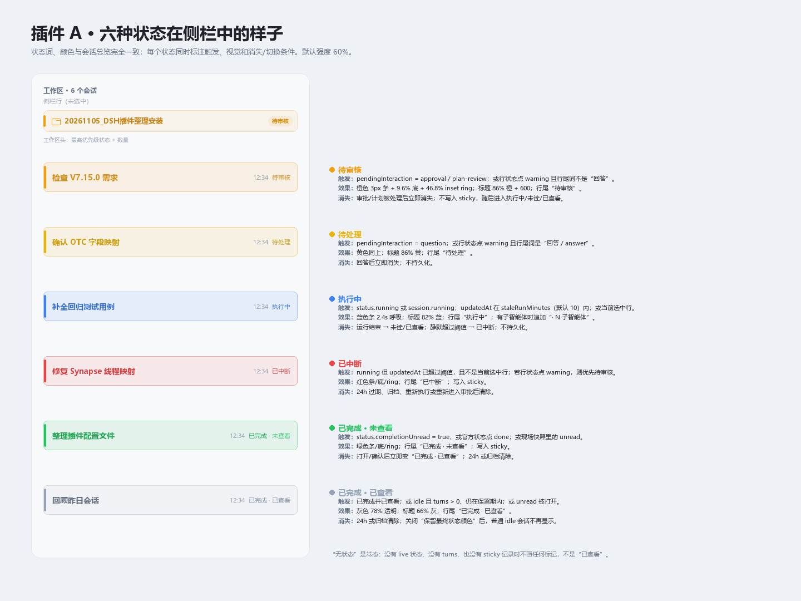
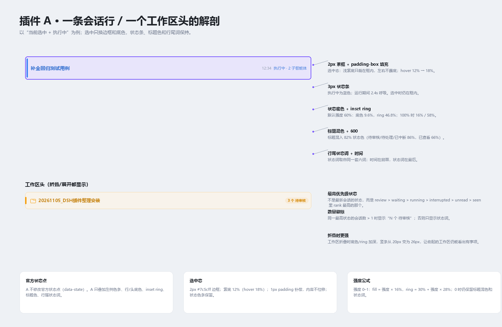
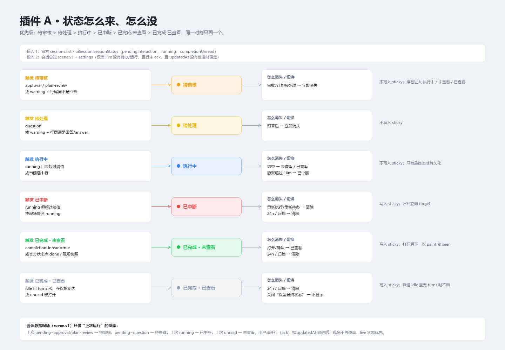
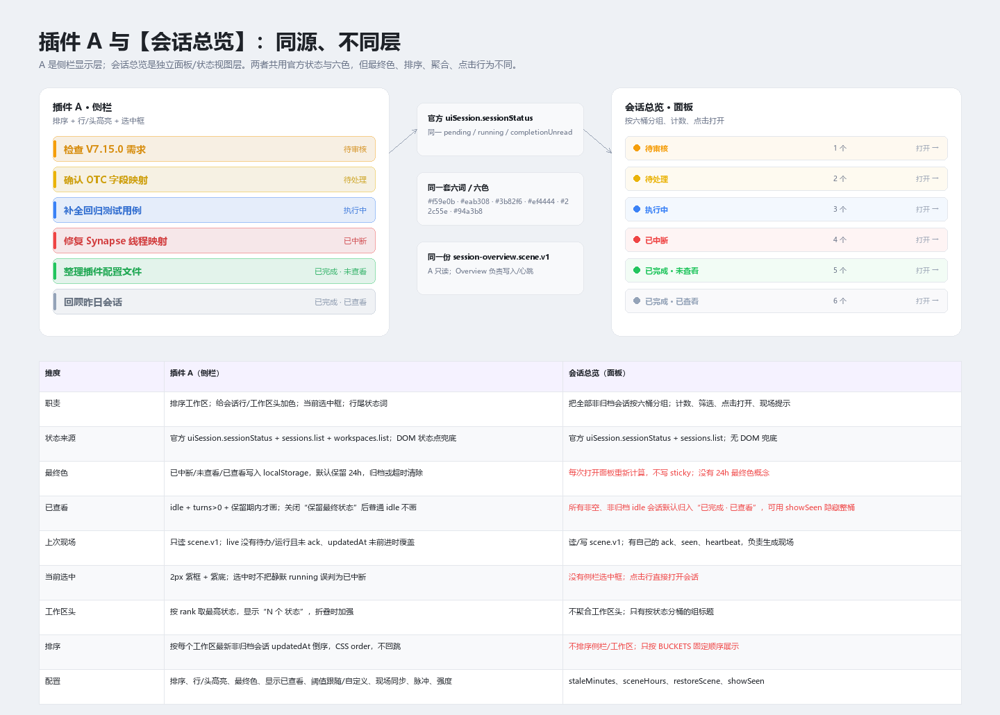

# fans会话状态监测总览的状态、排序与高亮规则

> 适用版本：`dsh-fans-session-monitor` **v1.2.6**  
> 原 A（侧栏高亮）与 C（会话总览）已合并为一个插件。  
> 所有颜色、状态词以本页和插件代码为准；默认高亮强度 60%。



## 0. 一句话结论

插件不是新的状态源，而是把 DSH 官方事实翻译成六个显示状态，并保证侧栏与会话总览使用同一结果。

数据源：

- `sessions.list`：标题、`updatedAt`、`running`、`agentAvailable`、子智能体数量；
- `workspaces.list`：工作区、`sessionIds`、`archivedSessionIds`；
- `uiSession.sessionStatus`：`pendingInteraction`、`running`、`completionUnread`；
- Host runtime（插件只读路由）：Host `bootAt`、Agent 是否 running、最后一个 turn 的
  `completed / interrupted / aborted / blocked / error / max-tokens / open`；
- `scene.v1`：上次关闭时的现场；
- `dsh-plugin-session-monitor:state:v1`：最终状态 sticky；
- `dsh-plugin-session-monitor:overrides:v1`：手动修正。

## 1. 七种状态

### 1.1 待审核（橙 `#f97316`）

触发：

- `pendingInteraction.kind = approval`：等待批准工具调用；
- `pendingInteraction.kind = plan-review`：计划等待确认；
- 或场景记录上次关闭前在等审批/计划确认。

视觉：3px 橙条、9.6% 橙底（强度 60%）、46.8% inset ring、标题 86% 橙、600 字重、行尾“待审核”。

切换：审批/计划被处理后立即消失，不写 sticky；通常进入执行中，或直接进入完成态。

### 1.2 待处理（黄 `#eab308`）

触发：

- `pendingInteraction.kind = question`：Agent 在等你回答；
- 或场景记录上次关闭前在等你回答。

视觉：黄色条/底/ring；标题 86% 黄；行尾“待处理”。

切换：回答后立即消失，不写 sticky。

### 1.3 执行中（蓝 `#3b82f6`）

触发，按优先级：

1. 当前选中行 DOM `data-state="ongoing"`；
2. Host runtime `running=true`（Agent 正在运行）；
3. `sessionStatus.running=true` 且存在 live Agent。

不再使用 `session.running` 这个可能残留的列表字段单独判运行。

视觉：蓝色 3px 条、2.4 秒呼吸动画、9.6% 底、46.8% ring、标题 82% 蓝、600 字重、行尾“执行中”；有子智能体时追加“· N 子智能体”。

切换：

- 运行结束且 Host completed → 未查看/已查看；
- 用户停止、Host interrupted/aborted/blocked/error/max-tokens → 已中断；
- 长时间无输出只追加“执行中 · N 分钟无新输出”，不改变状态；
- 不写最终态 sticky。

### 1.4 已中断（红 `#ef4444`）

触发（正向证据）：

- Host `turn/end` reason 为 `interrupted`、`aborted`（包括用户主动停止）、`blocked`、`error`、`max-tokens`；
- Host 重启时存在未闭合 turn；
- 非选中会话场景记录 running，且 Host 没有 completed 证据；
- 手动标记。

视觉：红色条/底/ring；标题 86% 红；行尾“已中断”。

切换：

- 重新执行/重新进入待办后清除；
- Host 报告 completed 时清除并转为未查看/已查看；
- 超过 `stickyHours` 或归档后清除；
- 写 sticky（如果开启“保留最终状态颜色”）。

**用户主动点停止属于已中断，不显示绿色已完成。**

### 1.5 已完成 · 未查看（绿 `#22c55e`）

触发：

- `completionUnread=true`；
- 或 Host `completed / forked` 且没有 `seenAt` 已读证据；
- 或场景 unread；
- 或 sticky unread（持续保留）。

视觉：绿色条/底/ring；标题 82% 绿；行尾“已完成 · 未查看”。

切换：

- 选中该会话或记录到 `seenAt` 后转已查看；
- 空闲重绘不会自动把 unread 改成 seen；
- 超过 `stickyHours` 或归档后清除；
- 写 sticky。

### 1.6 已完成 · 已查看（青 `#00c8c8`）

触发：

- 当前选中；
- 或场景/sticky 有 `seenAt` 证据；
- 或空闲且仍在最终色保留期内。

视觉：青色条/底/ring（比未查看的亮绿更沉的蓝青调）、标题 82% 青、行尾“已完成 · 已查看”。与“未查看”同属“已完成”家族但色相区分明显；“是否已查看”不再用灰色表达。

切换：

- `stickyHours` 到期；
- 会话归档；
- 关闭“保留最终状态颜色”后，普通 idle 不再显示最终色；
- 写 sticky。

### 1.7 已完结（灰 `#94a3b8`，仅手动）

触发（唯一入口）：

- 右键会话 → 「标记会话为已完结」。

这是阶段结束的人工确认：粗略点开过、但还没到收尾程度的会话保持“已完成 · 已查看”青色高亮；只有你手动标记后才进入安静的灰色。

视觉：与旧灰色“已查看”完全相同——灰色 78% 透明、标题 66% 灰、行尾“已完结”。

切换：

- 会话产生新活动（继续对话）、进入运行、出现待办或未读时，标记自动失效，恢复正常状态流转；
- `stickyHours` 到期；
- 会话归档；
- 右键「清除状态修正」。

### 1.8 无状态

以下同时满足时不画任何标记：

- 没有 live 的待审核/待处理/执行中/未查看/中断；
- 没有可用 sticky；
- 没有 turns，或已超过 `stickyHours`。

侧栏仍保留普通会话行；会话总览跳过 `bucket=null` 的这类会话。

## 2. 判定优先级

```text
手动 override
> 待审核 / 待处理
> 当前选中行 DOM ongoing
> Host runtime running
> live sessionStatus.running（需 live Agent）
> Host 中断证据
> Host completed（未查看/已查看）
> 场景 pending
> 场景 running（无 Host completed 时兜底）
> 场景 unread
> live unread
> sticky
> 过期 / 无状态
```

工作区头按最高优先级聚合：

```text
待审核 > 待处理 > 执行中 > 已中断 > 已完成·未查看 > 已完成·已查看 > 已完结
```

## 3. sticky、override、过期

### 3.1 sticky

只有三种最终态写入：

- interrupted；
- unread；
- seen。

活动态 review/waiting/running 只显示，不持久化。

清除：

- 会话归档；
- 最后活动超过 `stickyHours`（默认 24 小时，1–720）；
- 关闭“保留最终状态颜色”；
- 旧 A 的超时误写 interrupted 在迁移时丢弃。

### 3.2 手动修正

- 右键会话：标记为已中断 / 恢复为执行中 / 清除修正；
- 写入共享 override，侧栏和总览同时生效；
- 会话有新活动、running、pending 或 unread 后自动失效。

### 3.3 过期

- 最终色超过 `stickyHours` 后不再高亮；
- 总览不再统计；
- 侧栏保留普通行；
- 不会因为过期而被误判为已中断。

## 4. 侧栏和总览为什么统一

- 两侧调用同一个 `resolveStatus()`；
- 共用 sticky、override、scene、Host runtime；
- 当前选中行的 DOM `data-state` 通过共享变量传给总览；
- 总览只是跳过 `bucket=null`，不是另一套判定。

## 5. 视觉细节

### 5.1 会话行

- 状态条：左侧 3px；
- 底色：状态色 × 强度；
- ring：inset 1px；
- 标题：状态色混入标题颜色；
- 行尾状态词：与总览文案一致；
- 当前选中：2px 紫色外框 + 12% 紫底。

### 5.2 工作区头

- 取组内最高优先级状态；
- 显示状态徽标和数量；
- 多个同优先级会话显示“N 个 状态”；
- 运行组有呼吸/保持效果。

### 5.3 示例图







## 6. 配置项

配置只在插件详情页，按钮只有「保存配置」「恢复默认」。

| 配置 | 默认 | 范围/说明 |
|---|---:|---|
| 按最后活动时间排序工作区 | 开 | 关闭后官方顺序 |
| 高亮会话行 | 开 | 色条/底色/ring/标题/状态词 |
| 高亮工作区标题 | 开 | 头部底色/竖条/徽标 |
| 强调强度 | 0.6 | 0–1 |
| 显示「已完成 · 已查看」 | 开 | 关闭后两视图隐藏 seen |
| 行内显示工作区名 | 开 | 关闭后第二行只显示状态说明 |
| 紧凑模式 | 关 | 压缩行高并隐藏第二行 |
| 保留最终状态颜色 | 开 | 关闭后只显示实时状态 |
| 最终颜色保留时长 | 24 h | 1–720 |
| 长时间无输出提示 | 30 min | 0–1440，只提示，不改变 running |
| 运行停止时播放脉冲 | 开 | running → 非 running 绿色脉冲 |
| 恢复上次关闭时现场 | 开 | 记录/还原现场 |
| 现场有效期 | 72 h | 1–720 |

## 7. 已知边界

1. Host runtime 只覆盖 live 会话；非选中且没有 runtime 样本时，仍可能使用场景 running 兜底。
2. Host completed 但没有 seenAt 证据时按 unread 处理；个别历史已读会话可能在保留期内重新变绿。
3. review/waiting 依赖 `pendingInteraction.kind`；缺少 kind 时，选中行 warning 只能兜底为待审核。
4. 手动修正目前只支持 interrupted/running。
5. 会话总览不显示 `bucket=null` 的过期旧会话；侧栏保留普通行。

## 8. 验证

```bash
node --check lib/client.js
node --check lib/index.js
node test/run.mjs
```
